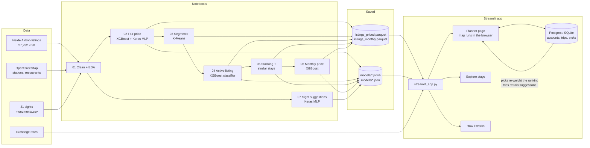

# Kervan · Istanbul trip planner

Pick the sights you want to see in Istanbul. Kervan finds the 5 Airbnb stays that suit that trip best, tells you which ones are fairly priced, and plans your days around the stay you choose.

**Live app:** [kervan.streamlit.app](https://kervan.streamlit.app)

NTI Machine Learning capstone, October 2026. Team: Marwan Mohammed, Ammar Ebrahim, Ibrahim Yousry, Adham Mohammed.

---

## The problem

Planning a city trip usually means two separate jobs that affect each other: choosing where to stay and working out what to see each day. Booking sites rank stays by price or rating, and they don't care whether the flat is an hour away from everything you came for. They also can't tell you whether a price is fair.

Kervan joins the two. It starts from the sights you chose, and every stay is judged by how well it fits that trip. Seven machine-learning models sit behind it, all trained on the Inside Airbnb snapshot of Istanbul (25 Sep 2026, 27,232 listings).

## What the app does

1. **Choose your trip.** Pick sights on the map, the number of days, guests, a ticket budget and a nightly budget. Not sure what to see? Tick your interests and press *Surprise me*, or take one of the *Travellers like you also added* suggestions.
2. **Get 5 stays.** Every listing that passes your filters gets six scores (price, deal, location, rating, trust, comfort). These are added up with weights that depend on what matters to you (*Save money*, *Balanced*, *Enjoy*). The best 5 are shown, each with its fair price and a one-line reason. You can compare them side by side or open *Similar stays*.
3. **Get a day-by-day plan.** Your sights are grouped into days by location (K-Means). Each day is put in walking order, with opening hours, prayer times at mosques, ferries and trams, sunset spots and restaurants nearby.

Travellers can use it as a guest or with an account. Accounts keep trips, and every trip people plan feeds back into the models (see *The app learns*).

---

## Architecture



**Heavy work happens offline, in the notebooks.** They clean the data, train the models and write a fair price, trust score, segment and similar stays for every listing into `data/processed/listings_priced.parquet`. The app only reads those files, so it starts fast and doesn't need TensorFlow.

**The planner runs in the browser.** `core/planner_html.py` takes the design template (`app/design_demo_template.html`) and fills in the real listings, their model outputs, the sights, the restaurants and the exchange rates. It writes `app/static/planner.html`, which the *Plan my trip* page shows full screen. The map, the scoring of stays, the day grouping, the routes and the suggestions network all run there in JavaScript (D3), so the map responds instantly.

**A two-way bridge links the page to Python.** It's an invisible Streamlit component in `app_pages/plan.py`. The planner sends sign-ins, saved trips, stay picks and "Good pick?" answers. Python stores them and sends back the account, the weights learned from picks, and suggestions built from real trips.

---

## The models

| # | Notebook | Question | Model | Result | Used in the app for |
|---|---|---|---|---|---|
| 01 | `01_data_prep_eda` | What does the market look like, and what drives price? | Cleaning + feature engineering | One clean table: own `stay_type` (hotels hide as "Private room"), distance to stations, restaurants and sights, amenities, host features. Leaky columns removed. | Everything below |
| 02 | `02_price_model` | What should this listing cost per night? | Baseline → Ridge → Random Forest → **XGBoost (tuned)**, plus our own **Keras MLP** with a district embedding. SHAP for explanations. | XGBoost ≈ 14% typical error, R² 0.753 on log price | Fair price on every stay, the **Deal** score, "x% below fair" tags, *Check a price* form |
| 03 | `03_segments` | What kinds of places are there? | **K-Means** on what a listing is and where it is (price not used) | 6 kinds of stay, and their prices separate clearly | *Kind of stay* filter in Explore, charts in How it works, so a hostel bed is never compared with a villa |
| 04 | `04_reliability` | Is a listing with no reviews a real, active place? | **XGBoost classifier** (vs logistic regression and Random Forest), trained on listings that have a history, no review columns | ROC-AUC 0.954 | **Trust** score for the ~35% of listings without reviews ("new listing, 72% likely active"), hides dead listings |
| 05 | `05_stacking_similar` | Can the neural network improve the price? Which stays are alike? | **Stacking** XGBoost + MLP (out-of-fold, linear meta-model). kNN on the MLP's hidden layer. | Stacked R² 0.756 vs 0.753 for XGBoost alone (weights ≈ 0.90 XGB + 0.13 MLP) | The fair price the app shows. *Similar stays* button. |
| 06 | `06_monthly_price` | What's fair for monthly rentals (28+ nights)? | **XGBoost** trained on monthly listings only | 33.9% typical error vs 63.5% when the normal model was reused | *Length of stay: a month or more* in the planner and Explore. Stops monthly rentals filling the deals list. |
| 07 | `07_suggest_model` | Which sight will this traveller add next? | **Keras MLP**: picked sights + ticked interests → a score for every sight. Trained by hiding one sight per trip. | Right sight in the top 3: 35.5% with interests ticked vs 30.6% for counting | *Travellers like you also added* in the planner |

### The app learns

Two models keep learning from people using the app:

- **Ranking weights** (`core/learning.py`). Each time someone plans with one of their 5 stays, we store the six scores of all 5 and which one they took. A pairwise logistic regression (conditional logit) learns how much each factor makes a stay more likely to be chosen. After 30 picks, the *Balanced* weights start moving towards the learned ones, gradually (`n / (n + 50)`).
- **Suggestions.** Saved trips record the sights and the ticked interests. Once there are 20 real trips, the counting fallback switches from sample trips to real ones. Re-running notebook 07 retrains the network on real behaviour.

---

## Repository layout

```
├── app/
│   ├── streamlit_app.py          # entry point: navigation, admin pages, visit count
│   ├── app_pages/
│   │   ├── plan.py               # "Plan my trip": the full-screen planner + the bridge to Python
│   │   ├── explore.py            # "Explore stays" (admin): every listing with its fair price and deals
│   │   └── how_it_works.py       # "How it works" (admin): model scores, live price checker, usage, figures
│   ├── core/
│   │   ├── data.py               # cached loaders for the parquet files, models and JSON
│   │   ├── planner_html.py       # builds app/static/planner.html from the template + real data
│   │   ├── learning.py           # weights learned from picks; suggestions from real trips
│   │   ├── auth.py               # accounts (salted PBKDF2), admin login, "keep me signed in"
│   │   ├── usage.py              # visitor count, picks and feedback (Postgres or SQLite)
│   │   └── ui.py                 # shared widgets (currency picker)
│   ├── design_demo_template.html # the planner page (HTML/CSS/JS, D3 map)
│   ├── demo_data/                # map shapes, sights, restaurants, stations, sample trips
│   ├── assets/                   # Kervan logo and icons
│   └── static/                   # generated planner.html + sight photos (served by Streamlit)
├── notebooks/                    # 01–07, run in order (see below)
├── src/                          # helpers shared by notebooks: geo, currency, recommender, day planner
├── data/
│   ├── raw/                      # Inside Airbnb listings, neighbourhoods, OSM stations and restaurants, sights, rates
│   └── processed/                # clean and priced tables written by the notebooks
├── models/                       # trained models (joblib, keras, json)
├── reports/figures/              # charts saved by the notebooks
├── presentation/                 # slide deck versions
├── requirements.txt              # what the app needs (Streamlit Cloud installs this)
└── requirements-notebooks.txt    # app + TensorFlow, SHAP, Jupyter for the notebooks
```

## Data

| Source | File | What we use it for |
|---|---|---|
| [Inside Airbnb](https://insideairbnb.com), Istanbul, 25 Sep 2026 | `data/raw/listings.csv.gz` | Listings, prices, reviews, hosts, amenities |
| Inside Airbnb | `data/raw/neighbourhoods.geojson` | District shapes on the map |
| OpenStreetMap | `stations.geojson`, `restaurants_eu.geojson`, `restaurants_asia.geojson` | Distance-to-transport features, restaurants near each day's route |
| Our own list | `data/raw/monuments.csv`, `app/demo_data/mon.json` | 31 sights: location, ticket price, visit time, opening hours, interests, popularity |
| Exchange rates | `data/raw/rates.json` | Prices in TRY, USD, EUR or GBP (all source prices are in lira) |
| Wikipedia / Wikimedia Commons | downloaded on first run | One photo per sight |

---

## Run it locally

Python 3.11.

```bash
git clone https://github.com/Marwanamer005/Airbnb-Istanbul-analysis-.git
cd Airbnb-Istanbul-analysis-
python -m venv .venv
.venv\Scripts\activate            # Windows  (macOS/Linux: source .venv/bin/activate)
pip install -r requirements.txt
streamlit run app/streamlit_app.py
```

The processed data and trained models are in the repo, so the app runs without re-running the notebooks.

### Optional secrets

Create `.streamlit/secrets.toml`. It's gitignored, so never commit it.

```toml
admin_password = "..."   # unlocks Explore stays and How it works (sign in as "admin" on the welcome card)
auth_secret    = "..."   # any long random string; signs the "keep me signed in" tokens
usage_db_url   = "..."   # Postgres link (e.g. Supabase). Without it, data goes to data/usage.sqlite
```

### Re-train the models

```bash
pip install -r requirements-notebooks.txt
```

Then run the notebooks from the `notebooks/` folder in this order:

**01 → 02 → 03 → 04 → 05 → 04 again → 06 → 07**

Notebook 04 runs twice because the second run uses the stacked price gap from 05. Restart the app afterwards: the planner page is built once per server start.

## Deployment

The app runs on Streamlit Community Cloud from this repo, with `app/streamlit_app.py` as the main file.

- `.streamlit/config.toml` turns on static serving (needed for the planner page) and sets the theme.
- The three secrets above go in the app's *Settings → Secrets*. Set `usage_db_url` too, otherwise accounts and trips are wiped every time the app restarts.
- Every push to the main branch redeploys the app.

## Limitations

- Prices are listed prices from one snapshot, not what guests actually paid, and Istanbul prices move with the season and the lira.
- "Active" in notebook 04 means *reviewed in the last 12 months*, which stands in for "booked recently".
- The suggestions network and the counting fallback start from 3,000 sample trips generated from sight popularity, interests and distance. They become meaningful as real trips come in.
- Opening hours are typical hours and weather chips are climate averages, not live data.
